<p align="center">
  
</p>

<h1 align="center">Lumen</h1>

<p align="center"><b>学术向的 RSS 阅读器：会议按截止日期排，书单拆成一本本书，期刊目录拼成整期。</b></p>

<p align="center">
  
  
  
</p>

<p align="center">
  <a href="https://github.com/Callioper/Lumen/releases/latest"><b>下载</b></a> ·
  <a href="https://callioper.github.io/Lumen/">主页</a> ·
  <a href="https://callioper.github.io/Lumen/demo/">演示站</a> ·
  <a href="CHANGELOG.md">更新日志</a> ·
  <a href="docs/tour.md">设计导览</a> ·
  <a href="#快速安装">快速安装</a> ·
  <a href="#常见问题">常见问题</a>
</p>

<p align="center">
  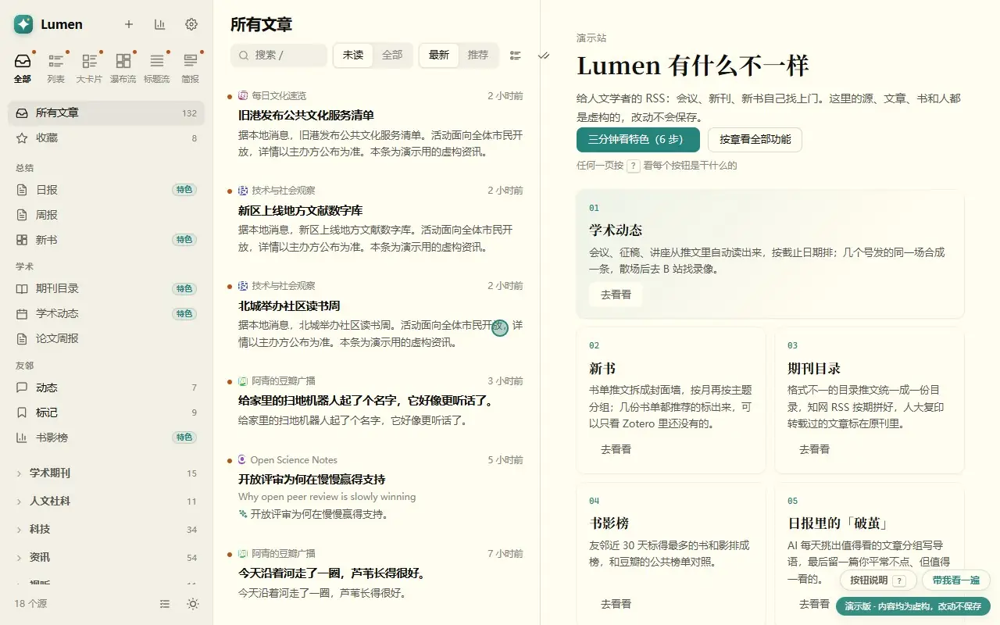
</p>

Lumen 是一个装在自己电脑上的 RSS 阅读器。订上学术公众号和期刊，推文里的会议会按截止日期排好，书单会拆成一本本书，期刊目录会拼成整期。

演示站里的订阅、文章和书都是编的，可以随便点。右下角「带我看一遍」会一章章带你看，按 `?` 能看到每个按钮是做什么的。

## 最近更新

**v0.2.0（2026-10-26）新增了首页。** 打开 Lumen，先看到今天的活动、快截止的征稿和快开始的会议，点一条，右边显示海报和时间地点。另外，存档的排版更干净，浏览器扩展能存公众号的「贴图」推文，设置里多了「关于」页，可以检查新版本；第一次打开、还没有订阅时，首页会列出先做的三步。

完整内容见 [更新日志](CHANGELOG.md)，网页版在 [主页的「更新」](https://callioper.github.io/Lumen/releases.html)。

## 用在哪

| 平时的麻烦 | 在 Lumen 里 |
|---|---|
| 打开阅读器不知道先看什么，快截止的会议埋在几百篇里 | **首页**：今天、快截止、快开始放在最前面，点一条看海报 |
| 会议征稿散在几十个公众号里，同一场会好几个号都发，想起来时已经截止 | **学术动态**：按截止日期排，同一场只留一条 |
| 期刊目录各有各的格式，知网 RSS 一篇一推，哪篇被人大复印转载了要另查 | **期刊目录**：拼成整期，转载的标回原刊 |
| 书单每周都有，同一本书几份书单都在推，翻过就忘 | **新书**：拆成一本本书，可以只看 Zotero 里没有的 |
| 豆瓣友邻在读什么，混在广播里 | **标记**、**书影榜** |
| 每天进来几百篇，想读的几篇被淹掉 | **日报** |
| 一周的新论文想按议题过一遍 | **论文周报** |
| 外文文章读得慢 | 任何一篇：标题直接显示中文，正文双语对照 |
| 记得意思，记不清用词 | 检索 →「意思相近」 |

每一页解决什么问题、数据从哪来、为什么这样做，写在 [设计导览](docs/tour.md) 里。

### 首页

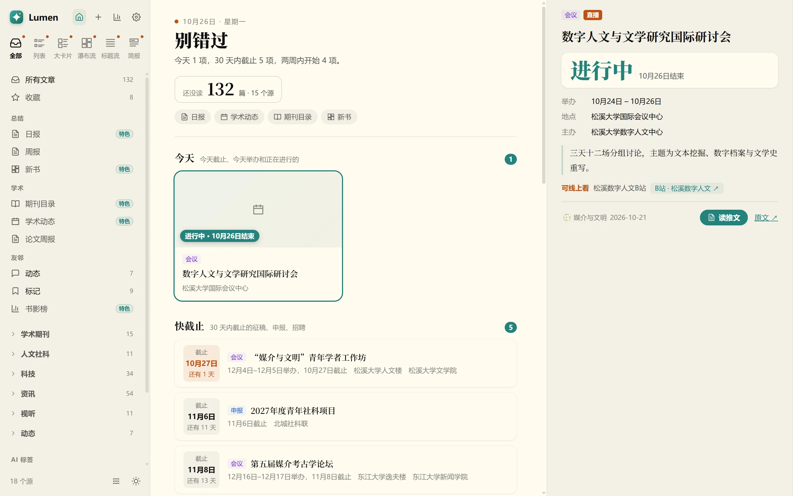

打开 Lumen 先到这一页。今天举办的活动是带封面的卡片，下面是 30 天内截止的征稿、申报和招聘，以及两周内开始的会议和讲座，再往下是新书和推荐先读。窗口够宽时，点任何一条，右边显示倒计时、时间地点和推文里的海报；海报是从推文的图片里挑出来的，二维码、动图、关注横幅都会去掉，配了 OCR 时按图里的字认海报和日程。点左上角的 Lumen 或房子按钮回到这里。

### 学术动态

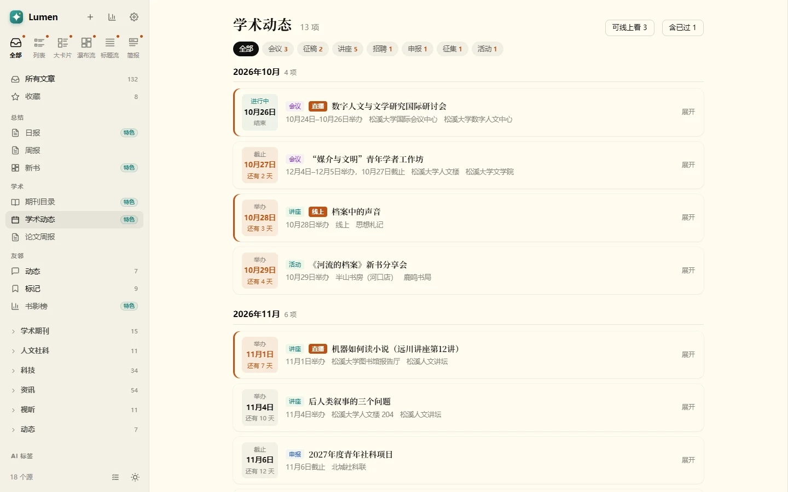

<details><summary>看操作动图：展开一条、按类型筛</summary>

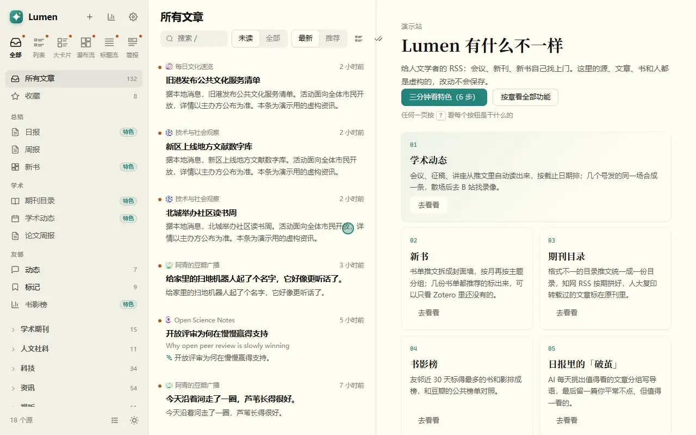

</details>

会议、征稿、讲座、招聘、申报，由 AI 从推文里读出来（只有海报的讲座先做 OCR），按截止日期排。同一场活动几个号都发了、第一轮第二轮通知各发一次，只出现一次，展开能看到每一篇原文。可以线上看的单独标出；讲座散场以后，Lumen 会去 B 站找录像，找到就挂在这一条下面。深色模式见[外观](#外观)。

### 新书

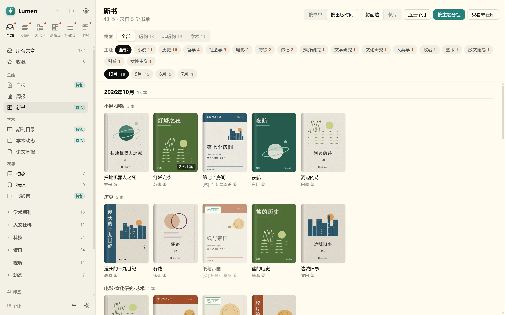

<details><summary>看操作动图：按类型、按主题筛</summary>


</details>

书单推文拆成一本本书，ISBN 或书名加出版社相同的算同一本，几份书单都推荐的标出来。按出版月份分组，书多的月份再按主题分架。可以只看 Zotero 里还没有的书（只读本地 Zotero 数据库，不写）。

### 期刊目录

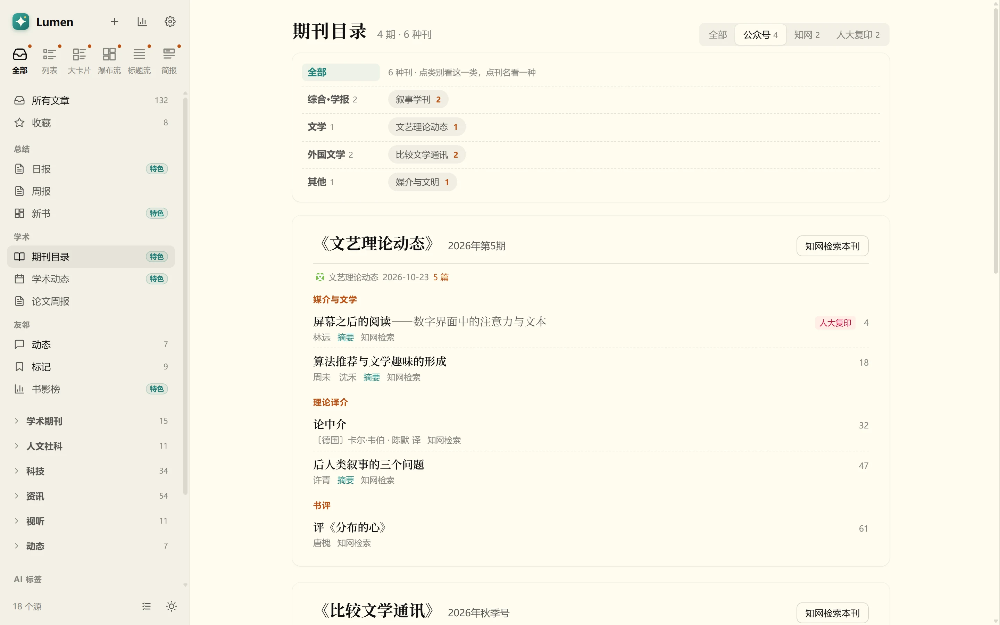

格式各异的目录推文统一成一种目录；知网 RSS 按刊名和期号拼回一期。被人大复印报刊资料全文转载的文章，在**原刊**的目录里标出来，因为人们是在原刊里找文章的。每篇旁边一个按钮去知网检索。

### 友邻标记与书影榜

<p>
  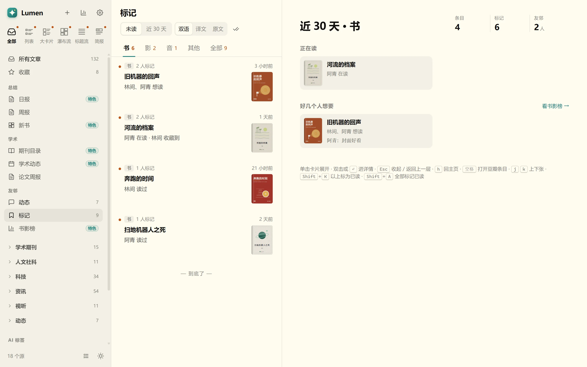
  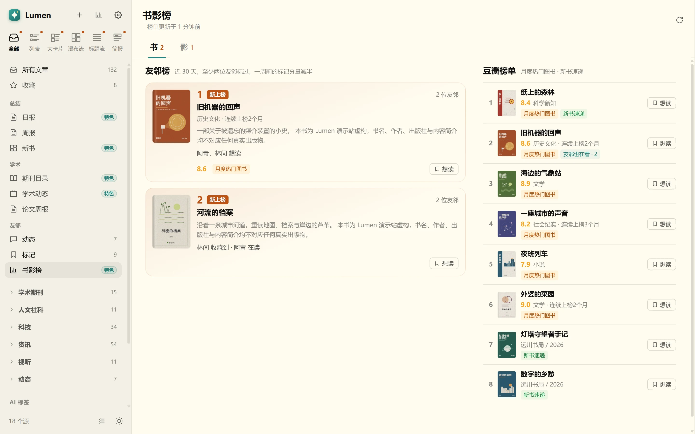
</p>

「标记」把友邻对同一本书的想读、在读、读过并成一张卡，按书、影、音分开。「书影榜」左边是友邻近 30 天标得最多的，右边是豆瓣的公共榜单，友邻也标过的标出来。

### 日报与论文周报

<p>
  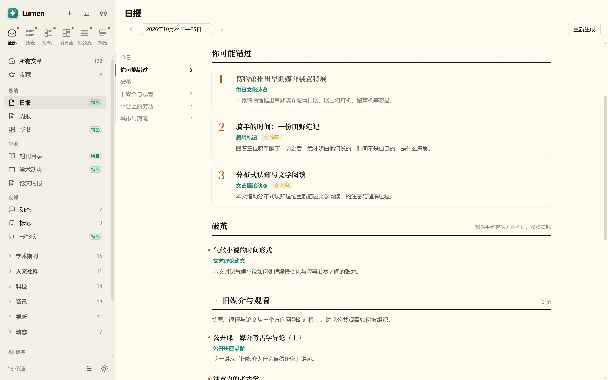
  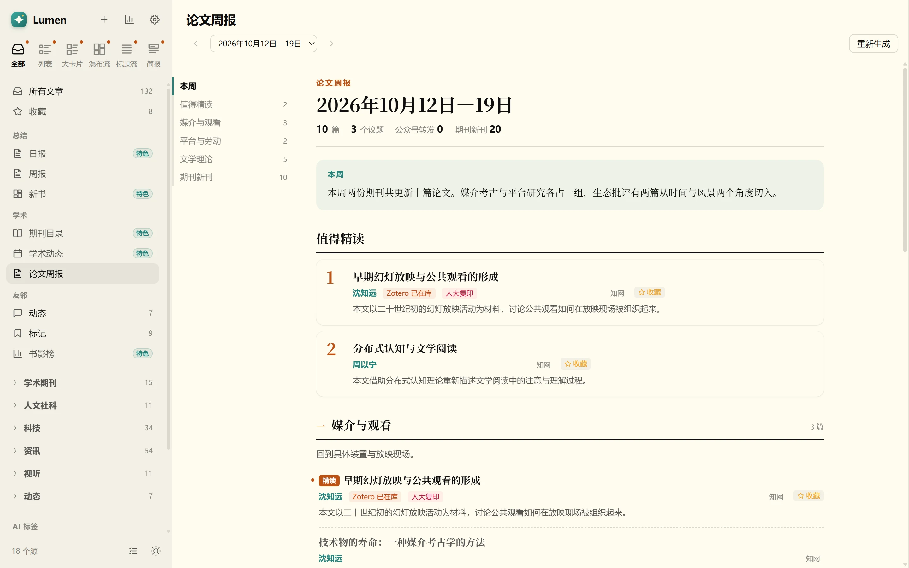
</p>

日报从当天进来的文章里按你的阅读画像挑，AI 分组写导语，每个源最多选几篇。最后的「破茧」是故意放进来的例外：一篇画像没覆盖到、你也从没点开过的文章。论文周报只收论文，按议题分组，标出 Zotero 是否在库、是否被转载。

推荐只看你明确做过的事：喜欢、少推、收藏、存档、读完（滚到底并且停够时间）。点开不算。

### 阅读

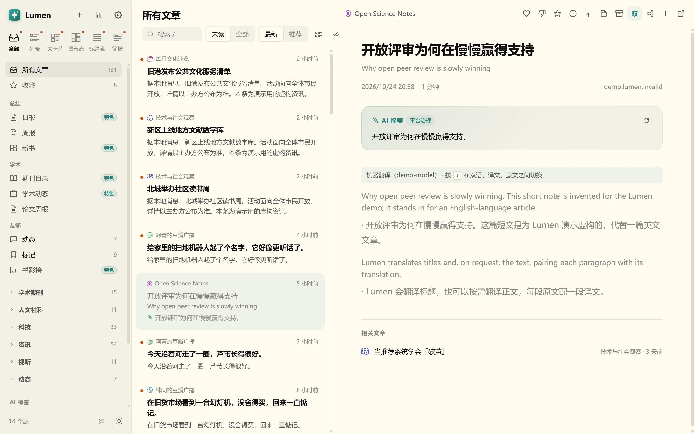

外文标题直接显示中文，原文作小字；正文可以在双语、译文、原文之间切换（`t` 键）。版式跟着源的类型走：资讯源默认标题流，图片源默认瀑布流，豆瓣、微博默认时间线，也可以按源、按分类改。

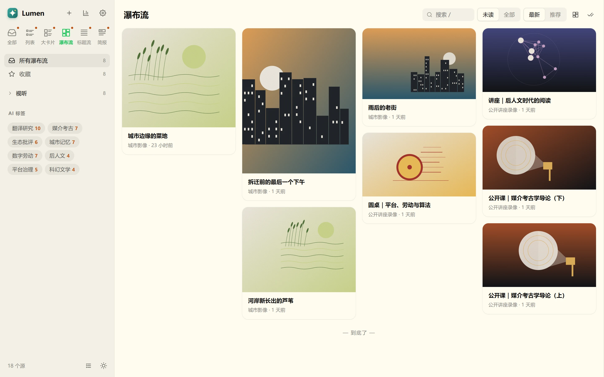

### 检索


默认按词，空格分开的词都要出现；换成「意思相近」，按语义找没出现这个词、但在说同一件事的文章。

### 存档与分享

- **存档（`c`）**：整理正文，AI 著录作者、译者、出处和标签，图片下载进库，写成一篇 Obsidian 笔记。
- **分享图（`p`）**：标题、摘要和指向原文的二维码；选中一段文字时做成摘录卡。

### 外观

<p>
  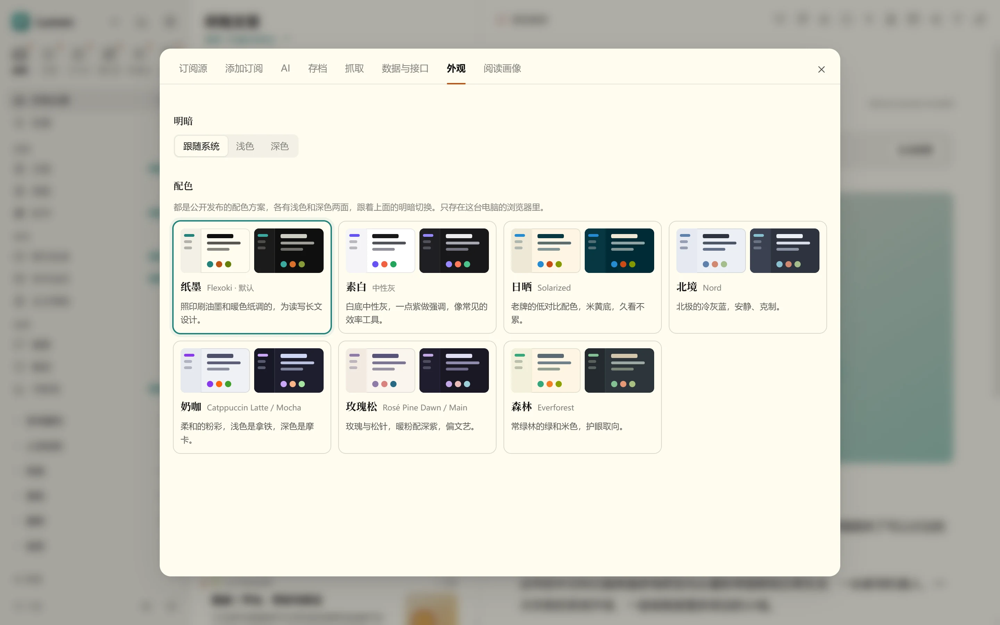
  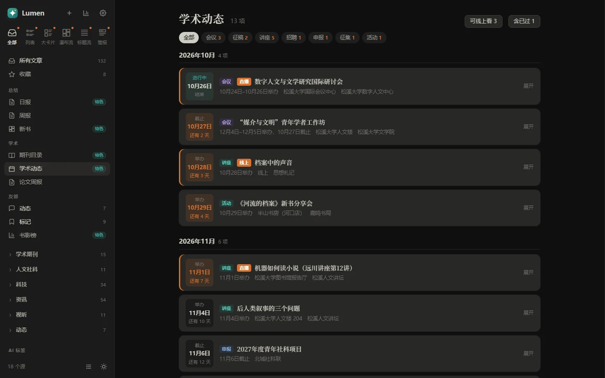
</p>

七套公开发布的配色：默认的纸墨（Flexoki），以及素白、日晒（Solarized）、北境（Nord）、奶咖（Catppuccin）、玫瑰松（Rosé Pine）、森林（Everforest），每套都有浅色和深色。

窄屏（手机浏览器）上侧栏收起，左下角的按钮把它拉出来；手机怎么连上 Lumen 见[常见问题](#常见问题)。

<p>
  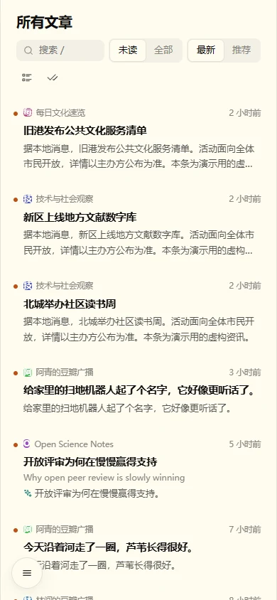
  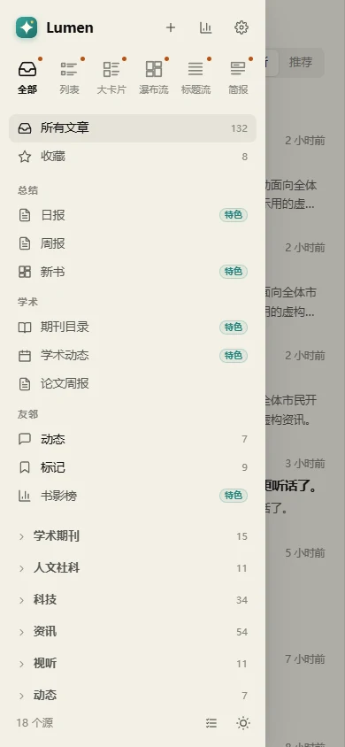
</p>

## 当前不做

- **不是云服务。** 没有云端账号、没有同步，数据只在你自己的电脑上。
- **不负责把网站变成 RSS。** 公众号、豆瓣、微博这类没有 RSS 的网站，需要你自己找可用的 RSS 来源，或者配上 RSSHub（见下）。
- **不下载知网全文，不内嵌知网页面。** 期刊目录里只给一个去知网检索的按钮。
- **不自带 AI。** 学术动态、期刊目录、日报、翻译要用你自己配的模型接口；不配也能当普通 RSS 阅读器用。
- **没有手机 App。** 可以用支持 Google Reader 接口的 RSS 客户端连过来。

## 快速安装

### 下载安装包（推荐）

到 [Releases](https://github.com/Callioper/Lumen/releases/latest) 下载对应的包，不用另装 Node.js：

| 系统 | 下载 | 第一次打开 |
|---|---|---|
| Windows 10/11 | `Lumen-<版本>-win-x64-setup.exe` | 安装包没有代码签名，Windows 可能提示「已保护你的电脑」：点「更多信息」→「仍要运行」。 |
| macOS（Apple 芯片） | `Lumen-<版本>-mac-arm64.dmg` | 没有经过 Apple 公证：第一次打开被拦下后，到 系统设置 → 隐私与安全性，点「仍要打开」。 |
| macOS（Intel） | `Lumen-<版本>-mac-x64.dmg` | 同上。 |
| Linux | `Lumen-<版本>-linux-x86_64.AppImage` | `chmod +x` 之后直接运行；也有 `.tar.gz`。 |

打开后是一个窗口。第一次还没有订阅，首页会列出先做的三步，每步一个按钮：在 设置 → 添加订阅 里粘贴 RSS 地址或网站首页；从别的阅读器搬过来，就在 设置 → 数据与接口 里导入 OPML；最后按需要配上 AI。

- 窗口开着的时候，Lumen 在后台按时抓取；Windows 和 Linux 上关掉窗口就停了，macOS 上关窗口后它留在程序坞里继续抓，退出才停。
- 它同时也是一个本机网页：菜单 文件 →「在浏览器中打开」，或者直接访问 <http://127.0.0.1:8780/>，浏览器扩展和手机客户端都连这个地址。
- 数据放在系统的应用数据文件夹里（菜单 文件 →「打开数据文件夹」），升级、重装都不会动它：Windows 是 `%APPDATA%\Lumen\data`，macOS 是 `~/Library/Application Support/Lumen/data`，Linux 是 `~/.config/Lumen/data`。

### 从源码运行

需要 Node.js 24 或更高版本（用到了 `node:sqlite` 和直接运行 TypeScript）。

```sh
git clone https://github.com/Callioper/Lumen.git
cd Lumen
npm ci
npm run build
npm start
```

然后打开 <http://127.0.0.1:8780/>。数据在仓库下的 `data/`。Windows 上可以用 `scripts/start.ps1` 一次在后台起 Lumen 和 RSSHub，`scripts/stop.ps1` 停掉。`npm run desktop` 以桌面窗口打开，`npm run dist` 打出本机系统的安装包。

### 可选的部分

每一项都可以不装，不装的功能会隐藏或提示去设置，其余照常用。

| 部分 | 用来做什么 | 怎么配 |
|---|---|---|
| AI（任何兼容 OpenAI 的接口） | 摘要、标签、翻译、学术动态和期刊目录的读取、日报 | 设置 → AI，填地址、模型和密钥 |
| 向量服务 | 意思相近的检索、相关文章、推荐 | 设置 → AI → 语义检索 |
| RSSHub | 豆瓣、微博、B 站这类没有 RSS 的网站 | 在 `rsshub/` 里 `npm ci`，再 `node server.mjs`（监听 1200）；需要登录的路由把 Cookie 写进 `rsshub/rsshub.env`，格式见 `rsshub/rsshub.env.example` |
| Zotero | 新书和论文周报里标出「已在库」 | 设置 → 抓取，填 `zotero.sqlite` 的位置（留空用默认位置），只读不写 |
| Obsidian | 存档 | 设置 → 存档，填库的位置；留空就不存档 |
| OCR（Python） | 只有海报的讲座推文、图片版的转载目录 | 设置 → 抓取，填 Python 和 OCR 引擎的位置，见 `scripts/ocr_images.py` |
| 浏览器扩展 | 在任意网页上存档、做分享图 | 见 [extension/README.md](extension/README.md) |

## 备份与升级

默认只保留 90 天内的文章，每个源最多 400 篇，更早的每天自动清掉；收藏的和存档过的不删。想长期留，改数据文件夹里 `settings.json` 的 `retention`。

所有数据在数据文件夹里（安装包版见上文；源码版是仓库下的 `data/`）：一个 SQLite 数据库、设置和密钥。Lumen 每周自动在其中的 `backup/` 里写一份压缩过的数据库副本，留最近四份；要换电脑或保险起见，复制整个数据文件夹就够了（Lumen 退出以后复制最稳妥）。

有没有新版本：设置 → 关于 →「检查更新」，或桌面版菜单 帮助 →「检查更新…」（Windows 和 Linux 上菜单栏默认收起，按 Alt 显示）。每个版本改了什么见 [更新日志](CHANGELOG.md)。

升级：安装包版下载新版本覆盖安装；源码版运行

```sh
git pull
npm ci
npm run build
```

然后重启。数据库新增的列在启动时自动补上，不需要手动迁移。

## 隐私

- Lumen 默认只监听本机（127.0.0.1），并检查请求的 Host；没有云端账号，也不上传任何东西。给手机用时可以打开登录，见[常见问题](#常见问题)。
- 会连出去的有：
  - 你订阅的源，和本机的 RSSHub；
  - 你配了才用的 AI 和向量服务；
  - 你按「检查更新」时问一次 GitHub 最新版本号，别的时候不连；
  - 几处公开页面，都不登录：豆瓣（书页、影片页和短评）、B 站（给散场的讲座找录像）、少数派（文章评论）、知网（识别期刊页、按期拼目录）。
- 密钥存在数据文件夹里的 `secrets.json`，只在本机。

## 常见问题

**不配 AI 能用吗？**
能。订阅、阅读、各种版式、按词检索、Google Reader 接口都不需要 AI。学术动态、期刊目录、日报和周报、翻译、摘要需要。

**能从 FreshRSS 搬过来吗？**
能（要用源码版来搬，搬完的数据文件夹安装包版也能用）。在 Lumen 目录下新建 `migrate-source/`，从 FreshRSS 的 `data/` 里拷三样进去，改成平铺的名字：`users/<用户名>/db.sqlite` 改名为 `<用户名>.sqlite`，`users/<用户名>/config.php` 改名为 `<用户名>-config.php`，以及 `config.php` 改名为 `system-config.php`。然后运行 `npm run migrate -- <FreshRSS 用户名>`，订阅、文章、已读和收藏一起搬过来。

**能在手机上看吗？**
Lumen 默认只监听本机，手机连不上。要让手机连：

1. 在 设置 → 数据与接口 里设好用户名和密码，打开「别的设备要登录」。
2. 把数据文件夹里 `settings.json` 的 `host` 改成 `0.0.0.0`，并用环境变量 `LUMEN_EXTRA_HOSTS` 列出电脑在局域网里的地址（如 `192.168.1.5:8780`），重启。

之后手机浏览器打开 `http://192.168.1.5:8780` 会先看到登录页；也可以用支持 Google Reader 接口的 RSS 客户端，填同一组用户名和密码。在电脑本机上用永远不用登录。

不开登录也能用，但那样同一网络里的任何设备都能打开 Lumen、读你的订阅、改设置（包括 AI 接口地址），启动时日志会提醒。登录走的是普通 HTTP，只适合家里这类信得过的局域网；不要直接暴露到公网，要从外面访问请自己套一层 HTTPS 反向代理或 VPN。

注意：Lumen 认「本机」看的是连接从哪来。在同一台电脑上跑的反向代理（nginx、Caddy）会带上转发头，Lumen 认得出来，照样要求登录；但 frp、ssh -R 这类只转发 TCP 的隧道不带任何头，从外面进来的请求看起来就像本机，登录会被绕过。要用隧道，请让隧道另一端自己做认证，或者改用 VPN。

**几个人能共用一个 Lumen 吗？**
Lumen 按一个读者设计：已读、收藏、推荐、日报、AI 读出来的学术动态都只有一份。多人用请各起一个实例（源码版），用环境变量 `LUMEN_DATA` 指定各自的数据目录，并在各自的 `settings.json` 里设不同的 `port`：

```sh
LUMEN_DATA=/srv/lumen-a npm start    # 订阅、设置、密钥都在 /srv/lumen-a
LUMEN_DATA=/srv/lumen-b npm start
```

**为什么学术动态里漏了一场会？**
AI 只读看起来像通知的推文；一篇推文汇总十几个会议时也会逐条读出来，但读错、读漏总会有。展开每一条都能看到原文，有问题以原文为准。

## 开发

```sh
npm run check     # 类型检查、测试、构建
npm run demo      # 生成虚构的演示数据，构建演示站（web/dist-demo）
npm run health    # 冒烟和各页的速度预算（要先 npm start）
```

## 致谢

简报、周报和检索的一些做法，受 [邸报](https://github.com/Pls-1q43/Dibao) 作者谈「省 Token」的文章启发：能用规则做的不交给模型。

## 许可证

[MIT](LICENSE)

`rsshub/` 里只有启动脚本和两条自写路由；RSSHub 本体是 [AGPL-3.0](https://github.com/DIYgod/RSSHub/blob/master/LICENSE)，不随本仓库分发，在 `rsshub/` 里 `npm ci` 时才装到你本机，按它自己的许可证使用。
